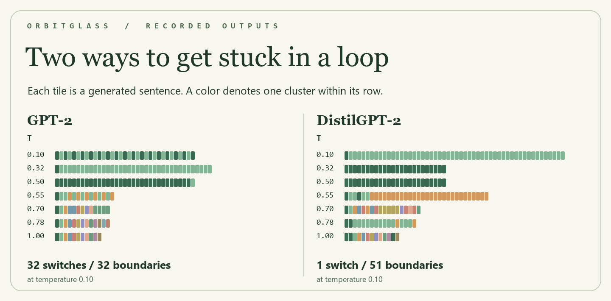
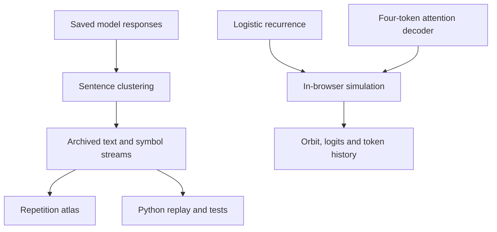

# Orbitglass · Inside Language Model Loops

**Can a model get stuck even when every sentence changes?** On the same prompt at temperature 0.10, GPT-2 switched sentence clusters at every boundary. DistilGPT-2 stayed in one cluster for its final 51 sentences. Both answers were repetitive. A detector that checks only whether adjacent sentences match would miss the first loop.

[**Open the live demo →**](https://adikan2k.github.io/orbitglass/#demo/1) · [Run locally](#run-the-interactive-lab) · [Read the illustrated report (PDF)](docs/files/Research_Report.pdf) · [Inspect the recorded sentences](data/sentence_traces.csv) · [Reproduce the findings](#reproduce-the-findings)



### A three-minute tour

| Open in the lab | Try it | What to look for |
| --- | --- | --- |
| **Repetition atlas** | Compare the two models at 0.10 and click the colored sentences. Then switch to 0.50. | An alternating loop can have a switch rate of 100% and still be perfectly predictable. At 0.50, a long run can carry a different stance. |
| **Logistic map** | Move the growth rate from 3.20 to 3.83. | A two-cycle gives way to a period-three window. The known update rule gives the period detector a reference case. |
| **Toy transformer** | Keep the prefix `ACCA` and move the first coordinate of B from 0.80 to 0.88. | The longest generated run of B grows from 6 to 21. Step through the logits to see how the model arrives at D. |

### Run the interactive lab

Download or clone this repository and open `docs/index.html` in a browser. Choose **Present demo** for the guided sequence. The app includes the archived sentences and runs both simulations in the browser. It works offline.

To serve the same site locally, run the following from the repository root and open [localhost:8000](http://localhost:8000).

```sh
python -m http.server 8000 --directory docs
```

### Findings and their limits

| Evidence | Result | How far the finding travels |
| --- | --- | --- |
| Two checkpoints, seven temperatures, same Earth-shape prompt | At 0.10, GPT-2 alternated across all 33 sentences. DistilGPT-2 switched once across 52. | One saved generation per model and temperature. Letters identify clusters within a response. |
| Four-token deterministic decoder | One embedding edit increased the B run from 6 to 21 over a fixed 26-token continuation. | A causal comparison inside the specified toy architecture. It isolates a mechanism that the observational sweeps cannot. |
| A recorded three-state transition matrix | Stationary weighting gives **0.951 bits/step**. Uniform weighting gives 0.507 and fails the stationarity check. | A correction for this matrix. Other archived entropy estimates need their own transition counts for recalculation. |
| Token-ID period sweeps | **181/200** Gemma 2 2B and **149/168** Qwen1.5-1.8B retained sequences had no exact period of 16 or shorter. | Different length filters and tokenizers limit comparison. An undetected short period leaves the question of chaos open. |
| Feedback-controller evaluation | Using entropy to predict a threshold on entropy gave 0.995 accuracy. Against a separate degraded-state label, F1 was 0 with just one positive among 200 outputs. | The first result measures threshold recovery. The second has too few positive examples to validate a quality alarm. |

The product question is whether a loop alert can catch wasted generation without interrupting tasks that require repetition. The archived examples give a team cases to test. A decision to intervene would need human labels, repeated seeds, matched decoding controls and task-level outcomes.

### Reproduce the findings

Python 3.10+ and its standard library are enough to replay the core results. From the root:

```sh
python examples/reproduce.py
python -m unittest discover -s tests -v
```

For a single example, count changes across neighboring sentence labels:

```python
from examples.reproduce import load_traces, summarize

stream = load_traces()["GPT-2", "0.10"]
print(summarize(stream))  # (33 sentences, 32 switches, longest run 1, period 2)
```

### Architecture



| Layer | Implementation |
| --- | --- |
| Web app | HTML, CSS, JavaScript, Canvas and SVG. Hash routes, keyboard controls, guided presentation and bundled research PDF. |
| Language-model experiments | Python, Jupyter, PyTorch and Hugging Face Transformers. GPT-2 variants, DistilGPT-2, GPT-Neo, Gemma and Qwen appear across the archive. |
| Measurement and networks | NumPy, pandas, SciPy, scikit-learn, NetworkX, Matplotlib and Gephi. The sentence atlas uses character n-gram TF-IDF with greedy cosine clustering. |
| Reproduction | Standard-library Python, plain CSV, GEXF and a browser-side math module. Generating fresh model outputs is a separate, heavier notebook workflow. |

### Explore the research

- [Methods, source crosswalk and contributor credits](research/README.md) — trace an exhibit back to its experiment, encoding and limitations.
- [13 source notebooks](research/notebooks/) — temperature sweeps, stance labels, logistic dynamics, attention, token graphs and feedback control.
- [Research data](data/) — 336 sentence records, a 40-stream paired sweep, a transition matrix and Gephi-compatible networks.
- [Browser math](docs/math.js) and [independent Python replay](examples/reproduce.py) — read the implementation at two levels.
- [32-page illustrated research report](docs/files/Research_Report.pdf) — model-size comparisons, mechanistic probes, network structure, feature steering and controller results.

Orbitglass was a three-person group research project at George Washington University. [Methods and source references](research/README.md).

