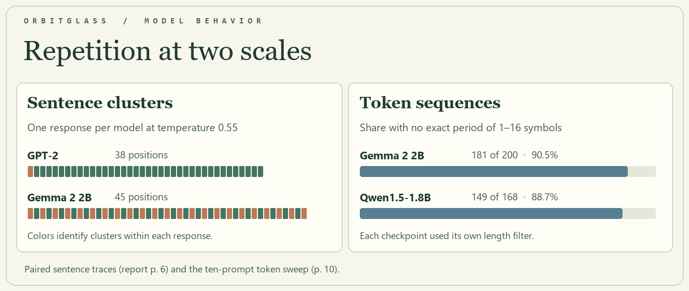

# Orbitglass · Inside Language Model Loops

**How do you tell a model that is exploring from one that is going in circles?** Our three-person group at George Washington University studied how decoding temperature changes the behavior of GPT-2, DistilGPT-2, GPT-Neo, Gemma and Qwen. We measured sentence repetition, tested token sequences for short cycles, and traced how an embedding change affects the next token.

[**Open the guided demo →**](https://adikan2k.github.io/orbitglass/#demo/1) · [Read the illustrated report](docs/files/Research_Report.pdf) · [Try three code examples](#three-code-examples) · [Run locally](#run-the-interactive-lab)



### Which models did we study?

| Models | What we examined | Where to inspect it |
| --- | --- | --- |
| **GPT-2 and Gemma 2 2B** | Sentence clusters at 20 temperatures from 0.05 to 1.00. A separate feedback controller used recent output to choose the next temperature. | [40 paired traces](data/paired_sweep.csv) · [Controller notebook](research/notebooks/temperature_controller_enhanced.ipynb) |
| **Gemma 2 2B and Qwen1.5-1.8B** | Token-level cycles across 10 prompts and 20 temperatures per checkpoint. The study retained 200 Gemma sequences and 168 Qwen sequences under different length filters. | [Period detection notebook](research/notebooks/gemma_qwen_period_sweep.ipynb) · [Reported counts, p. 10](https://adikan2k.github.io/orbitglass/files/Research_Report.pdf#page=10) |
| **GPT-2 and DistilGPT-2** | Repetition on one factual prompt at seven temperatures. These 336 saved sentences power the clickable **Repetition atlas** in the demo. | [Sentence-level data](data/sentence_traces.csv) · [Open the atlas](https://adikan2k.github.io/orbitglass/#lab/trace) |
| **GPT-2 Medium, Large, XL and GPT-Neo 1.3B** | Changes in stance, repeated answers and contradictions on the Earth-shape prompt. The evidence for these checkpoints is in figures and annotated outputs. | [Model-size comparisons, p. 5](https://adikan2k.github.io/orbitglass/files/Research_Report.pdf#page=5) |
| **GPT-2 and Gemma 2 2B Instruct** | Token embedding geometry in both checkpoints, plus layer-by-layer hidden-state graphs in GPT-2. | [GPT-2 embeddings](research/notebooks/gpt2_embedding_geometry.ipynb) · [Gemma Instruct embeddings](research/notebooks/gemma_embedding_geometry.ipynb) · [Network notebook](research/notebooks/hidden_state_networks.ipynb) |

For a wider comparison, the GW class poster plots temperature fingerprints for **Qwen2.5 1.5B, OLMo 2 1B, Pythia 1.4B, GPT-2 Medium, Mamba 1.4B, GPT-Neo 1.3B and Gemma 2 2B**. The published figure is the available evidence for those curves. [Poster and interpretation, p. 11](https://adikan2k.github.io/orbitglass/files/Research_Report.pdf#page=11)

### Three code examples

Each example runs independently from the repository root with Python 3.10+ and its standard library.

#### 1. Compare two models at the same temperature

At 0.55, GPT-2 ended with **37 consecutive sentences in one cluster**. Gemma 2 2B switched clusters at **all 44 boundaries**, alternating between A and B. A detector that only checks whether neighboring sentences share a cluster misses the second loop. This paired sweep clusters the prompt and continuation together. [Paired data](data/paired_sweep.csv) · [Generation and clustering notebook](research/notebooks/paired_gpt2_gemma_sweep.ipynb)

```python
from examples.reproduce import read_rows, summarize

for row in read_rows("paired_sweep.csv"):
    if row["temperature"] == "0.55":
        n, switches, longest, period = summarize(row["symbol_stream"])
        print(row["model"], n, switches, longest, period)
# model       positions  switches  longest run  exact period (up to 16)
# GPT-2              38         1           37  None
# Gemma-2-2B         45        44            1  2
```

#### 2. Check the entropy calculation against a known dynamical system

Before interpreting the Gemma and Qwen token sweeps, we can test the measurement on a logistic map. In this saved transition matrix, A and D always lead to B. Most uncertainty arises on leaving B, so how often the chain visits B matters. Weighting the rows by their stationary probabilities gives **0.951 bits per step**. [Transition counts](data/map_transition_counts.csv) · [Calculation, p. 9](https://adikan2k.github.io/orbitglass/files/Research_Report.pdf#page=9)

```python
from examples.reproduce import markov_entropy, read_rows

rows = read_rows("map_transition_counts.csv")
counts = [[int(row[state]) for state in ("A", "B", "D")] for row in rows]
weights, bits_per_step = markov_entropy(counts)
print([round(w, 4) for w in weights])  # [0.1245, 0.6252, 0.2504]
print(round(bits_per_step, 3))         # 0.951
```

#### 3. Change one embedding and replay the decoder

Keep the four-token vocabulary, the prefix `ACCA` and greedy decoding fixed. Moving B’s first coordinate from 0.80 to 0.88 extends its run from **6 to 21** before the model switches to D. The browser lets you inspect the attention context and next-token scores at each step. [Step through the decoder](https://adikan2k.github.io/orbitglass/#lab/toy) · [Python implementation](examples/reproduce.py)

```python
from itertools import groupby
from examples.reproduce import decode

for b_x in (0.80, 0.88):
    generated = decode(b_x)[len("ACCA"):]
    runs = [(token, len(list(group))) for token, group in groupby(generated)]
    print(b_x, runs)
# 0.8  [('A', 2), ('B', 6),  ('D', 18)]
# 0.88 [('A', 1), ('B', 21), ('D', 4)]
```

### A three-minute tour

| Open in the lab | Try it | What to look for |
| --- | --- | --- |
| **Repetition atlas** | Compare the two models at 0.10 and click the colored sentences. Then switch to 0.50. | An alternating loop can have a switch rate of 100% and still be perfectly predictable. At 0.50, a long run can carry a different stance. |
| **Logistic map** | Move the growth rate from 3.20 to 3.83. | A two-cycle gives way to a period-three window. The known update rule gives the period detector a reference case. |
| **Toy transformer** | Keep the prefix `ACCA` and move the first coordinate of B from 0.80 to 0.88. | The longest generated run of B grows from 6 to 21. Step through the logits to see how the model arrives at D. |


### Findings and their limits

| Evidence | Result | How far the finding travels |
| --- | --- | --- |
| Two checkpoints, seven temperatures, same Earth-shape prompt | At 0.10, GPT-2 alternated across all 33 sentences. DistilGPT-2 switched once across 52. | One saved generation per model and temperature. Letters identify clusters within a response. |
| Four-token deterministic decoder | One embedding edit increased the B run from 6 to 21 over a fixed 26-token continuation. | A causal comparison inside the specified toy architecture. It isolates a mechanism that the observational sweeps cannot. |
| A recorded three-state transition matrix | Stationary weighting gives **0.951 bits/step**. Uniform weighting gives 0.507 and fails the stationarity check. | A correction for this matrix. Other archived entropy estimates need their own transition counts for recalculation. |
| Token-ID period sweeps | **181/200** Gemma 2 2B and **149/168** Qwen1.5-1.8B retained sequences had no exact period of 16 or shorter. | Different length filters and tokenizers limit comparison. An undetected short period leaves the question of chaos open. |
| Feedback-controller evaluation | Using entropy to predict a threshold on entropy gave 0.995 accuracy. Against a separate degraded-state label, F1 was 0 with just one positive among 200 outputs. | The first result measures threshold recovery. The second has too few positive examples to validate a quality alarm. |

The product question is whether a loop alert can catch wasted generation without interrupting tasks that require repetition. The archived examples give a team cases to test. A decision to intervene would need human labels, repeated seeds, matched decoding controls and task-level outcomes.

### Run the interactive lab

Open `docs/index.html` in a browser or [download the offline demo](https://github.com/adikan2k/orbitglass/releases/download/v1.0.0/Orbitglass-Offline.zip). Choose **Present demo** for the guided sequence. To serve it locally, run `python -m http.server 8000 --directory docs` from the repository root and open [localhost:8000](http://localhost:8000).

Run `python examples/reproduce.py` to replay the core results. Run `python -m unittest discover -s tests -v` to check the saved traces, entropy calculation and decoder outputs.

### Architecture

| Layer | What happens |
| --- | --- |
| Generation | Python, Jupyter, PyTorch and Hugging Face Transformers produce model continuations under specified decoding settings. |
| Measurement | Character n-gram TF-IDF and cosine clustering turn sentences into symbol streams. The token-ID sweeps use a separate three-bin encoding. NumPy, pandas, SciPy and scikit-learn support the analyses. |
| Networks and mechanisms | NetworkX and Gephi expose hidden-state connectivity. The four-token decoder makes each attention calculation and next-token choice inspectable. |
| Interactive app | Static HTML, CSS, JavaScript, Canvas and SVG replay the saved sentences and compute the logistic map and toy decoder locally. Standard-library Python independently replays the headline results from CSV. |

[Explore the interactive architecture diagram](https://adikan2k.github.io/orbitglass/#architecture)

### Explore the research

- [Methods, source crosswalk and contributor credits](research/README.md) — trace an exhibit back to its experiment, encoding and limitations.
- [13 source notebooks](research/notebooks/) — temperature sweeps, stance labels, logistic dynamics, attention, token graphs and feedback control.
- [Research data](data/) — 336 sentence records, a 40-stream paired sweep, a transition matrix and Gephi-compatible networks.
- [Browser math](docs/math.js) and [independent Python replay](examples/reproduce.py) — read the implementation at two levels.
- [32-page illustrated research report](docs/files/Research_Report.pdf) — model-size comparisons, mechanistic probes, network structure, feature steering and controller results.


